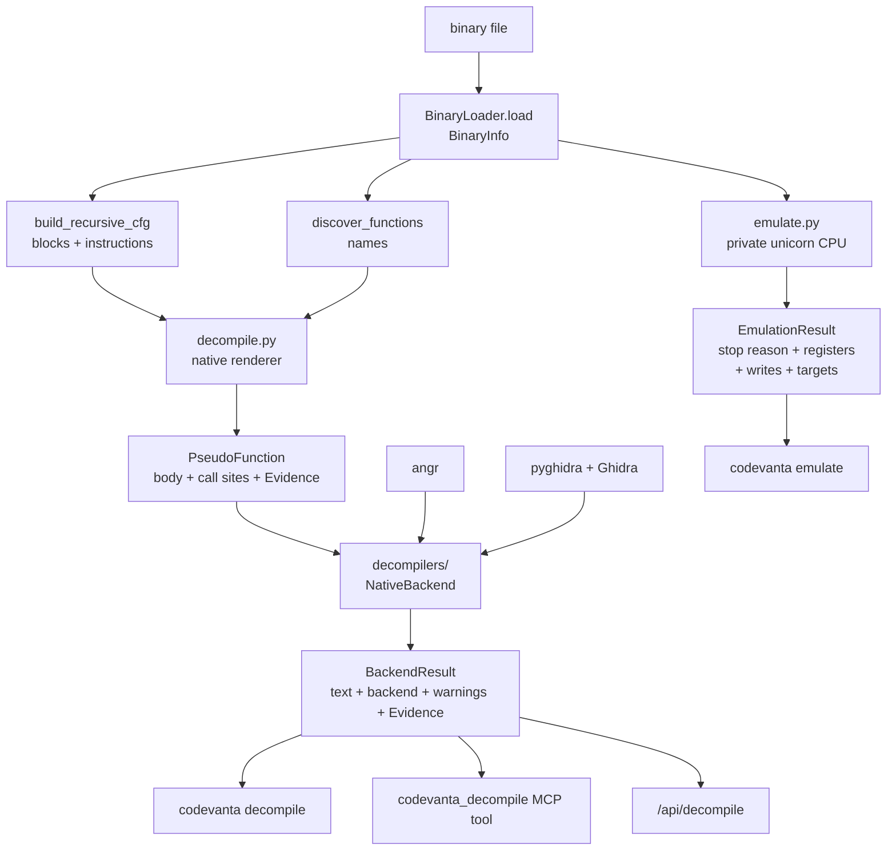

# Phase 3 — Pseudo-C decompilation, bounded emulation, decompiler backends

Phase 3 turns the phase 1/2 static views into two new answers: *what does this
function look like as C* and *what does this function actually compute for these
inputs*. Both are heuristic and both are bounded, and neither ever executes the
target on the host.

Everything below was verified against this branch (`feat/phase3-power`) on
Windows with Python 3.14.6, `capstone`, `lief` and `unicorn 2.1.4` installed.
Every command block is real output; the few things that could not be executed
here are listed in [What was not verified](#what-was-not-verified).

**Status:** new modules, new CLI commands, one new MCP tool and one new dashboard
route are implemented and tested. The external decompilers (Ghidra, angr) are
*wired up but not installed* in this environment, so those code paths are
exercised only through their unavailability branches (see the
[availability matrix](#the-availability-matrix-observed-here)).

## Goal

Three questions motivated the phase:

1. A static decoder shows `call qword ptr [rip + 0xa]` and stops. A human wants a
   readable body with an `if` and a loop.
2. A static decoder cannot propagate values, so *"what does this function
   return"* and *"where does this register-indirect jump land"* were
   unanswerable.
3. When a real decompiler happens to be installed, CODEVANTA should use it —
   without ever depending on it, and without ever silently substituting one
   provider for another.

## What shipped

| File | What it contains |
|------|------------------|
| `src/codevanta/analysis/decompile.py` | `decompile_function`, `PseudoFunction`, `CallSite`, the mnemonic-level renderer, budget constants |
| `src/codevanta/analysis/emulate.py` | `emulate_function`, `resolve_indirect_target`, `EmulationResult`, `xor_bytes`, `decrypt_string_loop`, all emulation limits |
| `src/codevanta/analysis/decompilers/__init__.py` | `available_backends`, `get_backend`, `decompile_function` (provider entry point), `auto` policy |
| `src/codevanta/analysis/decompilers/base.py` | `BackendAvailability`, `BackendResult`, `DecompilerBackend` protocol, `NativeBackend`, `require_budget` |
| `src/codevanta/analysis/decompilers/angr_backend.py` | angr provider and its `availability()` probe |
| `src/codevanta/analysis/decompilers/ghidra_backend.py` | Ghidra/pyghidra provider and its `availability()` probe |
| `src/codevanta/cli/main.py` | `codevanta decompile`, `codevanta emulate` |
| `src/codevanta/mcp_server/server.py` | the `codevanta_decompile` tool |
| `src/codevanta/gui/server.py`, `gui/layout.py` | `/api/decompile` route and the dashboard form |
| `tests/test_decompile.py`, `test_emulate.py`, `test_decompile_backends.py`, `test_cli_phase3.py` | phase 3 coverage |

Nothing in phase 1 or phase 2 changed shape: `decompile.py` reuses
`build_recursive_cfg` for decoding and block structure and `discover_functions`
for names, and `emulate.py` reuses `read_code` for file bytes.

## Architecture



Two independent paths share only the loader: decompilation is pure text over
decoded bytes, emulation copies those same bytes into a virtual CPU.

## 1. `codevanta.analysis.decompile` — heuristic pseudo-C

```python
from codevanta.analysis.decompile import (
    CallSite, PseudoFunction, decompile_function,
    DEFAULT_MAX_INSTRUCTIONS, DEFAULT_MAX_BLOCKS,
    MAX_MAX_INSTRUCTIONS, MAX_MAX_BLOCKS,
)

decompile_function(
    path, info, address,
    max_instructions=DEFAULT_MAX_INSTRUCTIONS,   # 2000
    max_blocks=DEFAULT_MAX_BLOCKS,               # 500
) -> PseudoFunction
```

`PseudoFunction` carries `address`, `name`, `lines` (the body without the header
and braces), `body` (header comment + signature + body), `call_sites`,
`block_count`, `instruction_count`, `truncated` and `evidence`; `to_dict()` is
JSON-safe. Each `CallSite` is `address`, `target` (`None` for an indirect
transfer), `name` and `kind` (`"call"`, `"jump"` for a tail call, `"unknown"` for
an unresolved indirect jump).

### The rendering rules

The renderer only *shapes* what the recursive CFG decoded, so these six rules are
the entire contract:

1. **Signature.** The argument count comes from the ABI argument registers read
   before the first `call` — `rdi`, `rsi`, `rdx`, `rcx`, `r8`, `r9` plus their
   32/16/8-bit aliases on x86-64, `ecx`/`edx` on x86 — capped at six. A register
   counts as *read* unless it is only the destination, so `mov rax, rdi` reads
   `rdi` while `mov rdi, rax` does not. The return type is `undefined64` /
   `undefined32` (the binary's bitness) and the parameters are `undefined64 a0,
   ...`; with no argument register read the signature is `(void)`.
2. **Operands.** Argument registers are renamed `a0`..`a5`; every other register
   keeps its architectural name. `[rbp - 8]`-style operands become frame slots
   (`local_0x8` below the frame pointer, `arg_0x8` above it), and other memory
   operands become `*(u64*)(...)` dereferences with the pointer width of the
   binary (`u32` for 32-bit files).
3. **Statements.** Only what the mnemonic alone justifies: `mov`/`lea`, compound
   assignments (`+=`, `^=`, ...) and the unary updates
   (`neg`/`not`/`inc`/`dec`). Every other instruction keeps its comment but emits
   no statement, so nothing is invented. Every emitted line carries the raw
   instruction text as a trailing `/* mov rax, rdi */` comment.
4. **Control flow.** A forward conditional branch with two decoded successors
   opens `if (<condition>) {` with the *inverted* condition (the fallthrough is
   the then-branch); when the then-branch jumps over an exclusive else region the
   halves are joined with `} else {`. A block that is the target of a back edge
   opens `while (1) {`, and the latch renders `continue;` or
   `if (<exit condition>) { break; }`. Everything else — irreducible edges,
   forward branches crossing an enclosing region, targets outside the decoded
   window — becomes `goto LABEL_<addr>;` / `goto 0x<addr>;` with a matching label.
5. **Conditions.** `cmp`/`test` operands feed the following branch: `je`/`jne`
   give `==`/`!=`, `jl`..`jg` give signed `< <= > >=`, `jb`..`ja` give the
   `(unsigned)` forms. With no justified comparison the condition is
   `flag_from_<mnemonic>`.
6. **Calls.** `call_<target>();` for a direct target, `<import_name>()` when the
   target matches `BinaryInfo.imports`, and `(*ptr)();` for an indirect one
   (recorded as `CallSite(target=None)`).

### The confidence and evidence contract

Every rendering is `Confidence.LOW` evidence, always — the whole text is a
mnemonic-level heuristic:

```text
source = "decompile.pseudo_c"
method = "mnemonic_heuristic"
detail = "pseudo-C rendered from N instruction(s) in M block(s) of a recursive
          traversal; argument count from ABI register reads, control flow from
          branch targets, widths from the pointer size; mnemonics only, nothing
          is executed"
```

The same facts are repeated in the header comment block (`address`, `symbol`,
`confidence`, `evidence`, `blocks`/`instructions`/`truncated`, `caveat`) so a
rendering copied out of a terminal still carries its own provenance. CFG warnings
(and the truncation warning) are appended there as ` * warning: ...` lines, at
most six plus a `(+N more)` line — the provider layer lifts exactly those lines
back out into `BackendResult.warnings`.

### Bounds

| Constant | Value | Meaning |
|----------|-------|---------|
| `DEFAULT_MAX_INSTRUCTIONS` | `2000` | instruction budget when the caller passes none |
| `MAX_MAX_INSTRUCTIONS` | `100000` (`MAX_DISASSEMBLY_COUNT`) | hard ceiling; larger requests are refused |
| `DEFAULT_MAX_BLOCKS` | `500` | block budget when the caller passes none |
| `MAX_MAX_BLOCKS` | `100000` | hard ceiling |

A cut-short rendering sets `truncated=True` and adds a `warning:` line instead of
failing. `AnalysisError` is raised only for a bad request: an address outside an
executable section, a budget below `1` or above its ceiling, or a region that
decodes to no instruction at all.

```powershell
codevanta decompile samples\pe64_text.bin --max-instructions 0
```

```text
error: max_instructions must be >= 1, got 0
```

(exit code `2`)

```powershell
codevanta decompile samples\pe64_text.bin 0x14000f000
```

```text
error: address 0x14000f000 is not inside an executable section
```

(exit code `2`)

## 2. `codevanta.analysis.emulate` — bounded, offline CPU emulation

```python
from codevanta.analysis.emulate import (
    EMULATOR_AVAILABLE, emulator_status, emulate_function,
    resolve_indirect_target, xor_bytes, decrypt_string_loop,
    DEFAULT_MAX_INSTRUCTIONS, DEFAULT_STACK_SIZE, EmulationResult, StopReason,
)

emulate_function(
    path, info, address,
    initial_registers=None,      # {"rdi": 2}
    initial_memory=None,         # {0x600000: b"..."}
    max_instructions=DEFAULT_MAX_INSTRUCTIONS,   # 2000
    stack_size=DEFAULT_STACK_SIZE,               # 0x10000
) -> EmulationResult

resolve_indirect_target(
    path, info, address,
    initial_registers=None,
    max_instructions=DEFAULT_MAX_INSTRUCTIONS,
    *, initial_memory=None,
) -> int | None

xor_bytes(data: bytes, key: int) -> bytes
decrypt_string_loop(data, key, *, key_step=0, op="xor", terminators=(0,)) -> bytes
```

**Nothing runs on the host.** Bytes come from the file (through
`codevanta.core.report.read_code`) and are copied into the image sections of a
*private* unicorn CPU. No host process, syscall or library is invoked: a call
into an import simply runs off the mapped image and the run stops as `unmapped`.
`EMULATOR_AVAILABLE` reports whether a unicorn build is importable at all, and
`emulator_status()` returns the empty string when it is (the reason otherwise).

**The ABI defaults are deliberately thin.** Only what a function may assume at
entry is seeded: `rip`/`eip` at the address and `rsp`/`rbp` (`esp`/`ebp`) near
the top of a stack region mapped at `STACK_BASE_64` (`0x7fff00000000`) or
`STACK_BASE_32` (`0x7e000000`). Argument registers are *not* guessed — pass
`initial_registers`, which is what makes a run reproducible.

**The work is bounded four ways at once**: the instruction budget is enforced in
the per-instruction hook (so the reported count and the stop reason can never
disagree), each mapping is capped, the total mapped memory is capped, and
recorded writes are capped with the overflow counted and warned about.

### Stop reasons

Every run ends with exactly one of these, plus a warning that explains it:

| `stopped_reason` | Meaning | What the result still contains |
|------------------|---------|-------------------------------|
| `return` | a `ret` popped an address outside the region of the section holding `address` | `return_value` from `rax`/`eax` |
| `budget` | `max_instructions` instructions completed, the next was stopped before it ran | `instructions == max_instructions`, **no** `return_value` |
| `unmapped` | the code touched an address that is not mapped (protection faults land here too); the faulting address is in `warnings` | the register snapshot at the fault |
| `unsupported` | the architecture is not x86/x86-64, unicorn cannot decode, or unicorn is not installed | nothing: `instructions=0`, empty registers, `Confidence.UNKNOWN` |
| `error` | unicorn raised because of the emulated code (`UC_ERR_EXCEPTION`, e.g. divide by zero) or failed internally | whatever was recorded before the failure |

A `ret` that pops an address *inside* the same section region is an ordinary
intra-region return and emulation continues — that is how tail calls and
code-pushed callbacks work.

`EmulationResult` carries `address`, `stopped_reason`, `instructions`,
`return_value`, `registers`, `memory_writes` (`(address, bytes)` in store order),
`indirect_targets`, `warnings` and `evidence`; `to_dict()` hex-encodes every
value. Its evidence is `Confidence.MEDIUM`, `source="emulate.unicorn"`,
`method="bounded_cpu_emulation"`, and `extra` records the budget, the mapped
`regions`, `stack_base`, `stack_size` and the write/target counters.

`emulate_function` only raises `AnalysisError` for a caller mistake: an address
outside an executable section or without file bytes, a budget/stack size out of
range, an unknown register name, a register value that does not fit the machine
word, or an `initial_memory` block that breaks the limits. Limitations are never
raised — they are reported through `stopped_reason` and `warnings`.

### Limits

| Constant | Value | Meaning |
|----------|-------|---------|
| `DEFAULT_MAX_INSTRUCTIONS` | `2000` | budget when the caller passes none |
| `MAX_MAX_INSTRUCTIONS` | `100000` | hard ceiling on `max_instructions` |
| `DEFAULT_STACK_SIZE` | `0x10000` (64 KiB) | mapped stack when the caller passes none |
| `MAX_STACK_SIZE` | `0x1000000` (16 MiB) | ceiling on `stack_size`; below `PAGE_SIZE` is refused |
| `PAGE_SIZE` | `0x1000` | unicorn needs page-aligned addresses *and* sizes |
| `MAX_SECTION_BYTES` | `0x1000000` (16 MiB) | a larger section is not mapped (warning instead) |
| `MAX_TOTAL_MAPPED` | `0x4000000` (64 MiB) | image + stack + `initial_memory`, total |
| `MAX_INITIAL_BLOCKS` | `32` | at most this many `initial_memory` blocks |
| `MAX_INITIAL_BLOCK_BYTES` | `0x100000` (1 MiB) | largest single `initial_memory` block |
| `MAX_MEMORY_WRITES` | `256` | recorded stores; the rest are counted and warned about |
| `STACK_BASE_64` | `0x7fff00000000` | 64-bit stack mapping base |
| `STACK_BASE_32` | `0x7e000000` | 32-bit stack mapping base |

### `resolve_indirect_target` — the static-analysis bridge

`jmp rax` and `call qword ptr [rip + 0x10]` cannot be resolved by decoding. This
helper seeds the registers the branch depends on, runs *up to* the first indirect
jump/call and returns its target. `None` means **"not resolved"**, never "no
target": no indirect branch was reached, the operand could not be evaluated, or
the binary is not emulatable.

Because the target is read out of the file image, a PE import slot yields
whatever the loader has not yet relocated — an ILT/name RVA rather than code.
That is a property of the file, not a bug in the resolver:

```powershell
codevanta emulate C:\Windows\System32\notepad.exe --resolve-target --max-instructions 400
```

```text
indirect target: 0x32e30 (208432)
```

### The XOR/string helpers

`xor_bytes` and `decrypt_string_loop` are pure functions over bytes; they never
emulate or execute anything. They exist so that a key recovered from the emulator
(a register, or one of `memory_writes`) can be applied to the ciphertext and
documented. `decrypt_string_loop` models the encode loops packers emit — `op` is
the operation the **encoder** applied (`"xor"`, `"add"`, `"sub"`, i.e.
`DECRYPT_OPS`) and decoding inverts it — with an optional `key_step` per byte and
C-style termination:

```python
from codevanta.analysis.emulate import decrypt_string_loop, xor_bytes

plain = b"C:\\secrets\\cfg.ini"

# fixed key: the encode loop XORs the text and its NUL terminator
cipher = xor_bytes(plain + b"\x00", 0x5A)
print(cipher.hex())
print(decrypt_string_loop(cipher, 0x5A))

# rolling key: +1 per byte, which is the other loop shape packers emit
rolling = bytes(byte ^ ((0x5A + index) & 0xFF) for index, byte in enumerate(plain + b"\x00"))
print(decrypt_string_loop(rolling, 0x5A, key_step=1))

# ADD encoder, whole blob (no terminator filtering)
added = bytes((byte + 0x10) & 0xFF for byte in b"OK")
print(decrypt_string_loop(added, 0x10, op="add", terminators=()))
```

```text
196006293f39283f2e2906393c3d743334335a
b'C:\\secrets\\cfg.ini'
b'C:\\secrets\\cfg.ini'
b'OK'
```

An `op` outside `DECRYPT_OPS` is refused:
`AnalysisError: op must be one of ('xor', 'add', 'sub'), not 'rol'`.

### The faulthandler note

Unicorn resolves guest faults (`UC_ERR_READ_UNMAPPED` and friends) with its own
signal/SEH handler. On Windows, CPython's `faulthandler` prints a
`Windows fatal exception: access violation` block *before* unicorn's handler runs,
which looks like a crash in a test log even though the emulation is fine.
`emulate.py` therefore disables `faulthandler` for the duration of `emu_start` and
restores whatever state the caller had.

That suppression window covers `emu_start` only. The same message can still
appear on stderr from `uc.mem_map` inside `setup()`, before any guest instruction
runs; the run is unaffected and the tests still pass (exit code `0`):

```text
.Windows fatal exception: access violation

Current thread 0x00008824 (most recent call first):
  File "...\\unicorn\\unicorn_py3\\unicorn.py", line 831 in mem_map
  File "D:\\PALIKASIKU\\CODEVANTA\\src\\codevanta\\analysis\\emulate.py", line 655 in _commit
  File "D:\\PALIKASIKU\\CODEVANTA\\src\\codevanta\\analysis\\emulate.py", line 651 in _map_pages
  ...
  File "D:\\PALIKASIKU\\CODEVANTA\\tests\\test_emulate.py", line 212 in test_mov_eax_42_returns_42
............................                                            [100%]
```

## 3. `codevanta.analysis.decompilers` — the provider layer

```python
from codevanta.analysis.decompilers import (
    available_backends, get_backend, decompile_function,
    BackendAvailability, BackendResult, DecompilerBackend,
    NativeBackend, supported_backends, AUTO, LANGUAGE,
)

available_backends() -> tuple[BackendAvailability, ...]   # ghidra, angr, native
get_backend(name) -> DecompilerBackend                    # AnalysisError on unknown
decompile_function(path, info, address, backend="auto",
                   max_instructions=2000, max_blocks=500) -> BackendResult
```

`BackendAvailability` is `name`, `available`, a **non-empty** `reason` (what was
detected when available, what is missing plus an install hint when not) and the
`requires` tuple. A probe never raises and never installs anything: a missing
package becomes `available=False`, never an `ImportError`.

`BackendResult` is `text` (never empty — a backend with nothing to say returns an
explanatory `/* ... */` comment plus a warning), `backend` (the provider that
*actually* produced the text, which under `auto` may differ from the request),
`language` (`LANGUAGE = "c"`), `warnings` and `evidence`.

### Selection policy

| Request | Behaviour |
|---------|-----------|
| `backend="native"` | always runs; the built-in renderer needs no optional dependency |
| `backend="angr"` / `"ghidra"` | **strict**: if unavailable, `AnalysisError` naming the backend and the probe's reason (install hint included). Never substitutes another provider, never leaks `ImportError` |
| `backend="auto"` (default) | prefers `ghidra`, then `angr`; falls back to `native`, adding one warning per skipped backend so a fallback is never silent |

Budgets are validated once, in the provider layer (`require_budget`), before any
backend is touched: an out-of-range `max_instructions` / `max_blocks` is refused
identically whichever backend you asked for.

### The availability matrix observed here

```python
from codevanta.analysis.decompilers import available_backends

for probe in available_backends():
    print(probe.name, probe.available, "|", probe.reason, "|", probe.requires)
```

```text
ghidra False | the 'pyghidra' package is not installed (ModuleNotFoundError: No module named 'pyghidra'); pip install pyghidra and download Ghidra, then set GHIDRA_INSTALL_DIR to the installation directory | ('pyghidra', 'ghidra')
angr False | the 'angr' package is not installed (ModuleNotFoundError: No module named 'angr'); install it with 'pip install angr' | ('angr',)
native True | built-in mnemonic-level pseudo-C renderer; needs no optional dependency and always runs | ()
```

| Backend | `requires` | Runs when | Observed here |
|---------|-----------|-----------|---------------|
| `ghidra` | `("pyghidra", "ghidra")` | `pyghidra` imports **and** `GHIDRA_INSTALL_DIR` points at a directory containing `support/`, `ghidraRun` or `ghidraRun.bat` | unavailable — `pyghidra` is missing. `GHIDRA_INSTALL_DIR` *is* set (`D:\tools\ghidra_12.1.4_PUBLIC`, which has `support\` and `ghidraRun.bat`), so only the Python package is missing |
| `angr` | `("angr",)` | `angr` imports | unavailable — package missing |
| `native` | `()` | always | available |

### How to unlock real C output

There are two real providers and **one** extra for both of them, so nothing
heavy ever lands in a plain `pip install`:

| Install | Gives you | Unlocks |
|---------|-----------|---------|
| `pip install -e ".[decompilers]"` | `angr` **and** `pyghidra` | the `angr` backend outright; `pyghidra` is the *Python half* of the `ghidra` backend |
| a Ghidra release (`~570 MB`) + `GHIDRA_INSTALL_DIR` | Ghidra itself | the *other half* of the `ghidra` backend |

`pyghidra` sits in `decompilers` instead of in an extra of its own because the
bridge installs on its own: `python -m pip install --dry-run pyghidra` resolves to
a ~360 kB JPype wheel plus `typing_extensions` and `packaging` — no Ghidra, no
JDK, nothing pip could not fetch. Only *using* it needs both halves. So pip never
downloads Ghidra behind your back, and a machine that already has Ghidra on disk
unlocks the backend from the same extra instead of hunting for a second one.

Ghidra first, because `auto` prefers it:

```powershell
# 1. the Python bridge (angr ships in the same extra)
python -m pip install -e ".[decompilers]"

# 2. a Ghidra installation, then point CODEVANTA at it
$env:GHIDRA_INSTALL_DIR = "D:\tools\ghidra_12.1_PUBLIC"   # contains support\ and ghidraRun.bat
```

`angr` alone is enough for the `angr` backend, and it is what the blocking
`decompile-parity` CI job installs.

Confirm the probe before asking for a strict backend:

```powershell
python scripts/check_decompiler_backends.py
```

Nothing else changes: the same `codevanta decompile --backend ghidra` /
`--backend angr`, `/api/decompile?backend=ghidra` and `codevanta_decompile` calls
then return that provider's text with its own evidence (`ghidra.decompiler` /
`pyghidra.headless.DecompInterface` or `angr.decompiler` /
`analyses.Decompiler`) and `language="c"`. The native renderer stays the fallback
for machines with neither, and the Ghidra provider projects the instruction budget
onto its decompiler timeout (200 instructions per second, clamped to 5–300 s).

#### Is the ghidra backend actually tested?

Yes — by the `ghidra-parity` job in `.github/workflows/ci.yml`, and **best
effort on purpose**. That job downloads the pinned Ghidra release (~570 MB) from
the official GitHub releases, verifies its published SHA-256, unpacks it, exports
`GHIDRA_INSTALL_DIR`, sets up Temurin JDK 21 (Ghidra 12.1 requires JDK 21; 12.2
requires JDK 25, so the two are bumped together), installs
`-e ".[dev,decompilers]"`, asserts that
`python scripts/check_decompiler_backends.py` reports `ghidra  available`, and
then runs `python -m pytest tests/test_decompiler_parity.py -q -k ghidra`.

It is `continue-on-error: true` because the download and the JVM are outside this
repository's control, so it can never block a merge; the blocking gate for the
provider layer stays `decompile-parity` (angr, wheels only). The job never lies
about what it did: if Ghidra cannot be fetched or unpacked it prints a
`::notice::` line saying the ghidra backend was **not** exercised. The tests are
guarded the same way — they `skip` (they do not pass vacuously) when `pyghidra`
or `GHIDRA_INSTALL_DIR` is missing, which is what happens on a developer machine
with neither installed.

## Surfaces

### `codevanta decompile`

```powershell
codevanta decompile samples\pe64_text.bin
```

```text
+----------------------- Decompilation at 0x140001000 ------------------------+
| /*                                                                          |
|  * CODEVANTA pseudo-C decompilation (heuristic, phase 3)                    |
|  * address: 0x140001000                                                     |
|  * symbol: codevanta_sample_main                                            |
|  * confidence: low                                                          |
|  * evidence: decompile.pseudo_c / mnemonic_heuristic - pseudo-C rendered    |
| from 8 instruction(s) in 1 block(s) of a recursive traversal; argument      |
| count from ABI register reads, control flow from branch targets, widths     |
| from the pointer size; mnemonics only, nothing is executed                  |
|  * blocks: 1  instructions: 8  truncated: false                             |
|  * caveat: control flow, argument count and types are inferred from         |
| mnemonics; nothing is executed                                              |
|  */                                                                         |
| undefined64 codevanta_sample_main(void)                                     |
| {                                                                           |
|     rsp -= 0x28;  /* sub rsp, 0x28 */                                       |
|     eax ^= eax;  /* xor eax, eax */                                         |
|     a5 = rax;  /* mov r9, rax */                                            |
|     a3 = 0x140001025;  /* lea rcx, [rip + 0x15] */                          |
|     a2 = 1;  /* mov edx, 1 */                                               |
|     call_14000101f();  /* call 0x14000101f */                               |
|     rsp += 0x28;  /* add rsp, 0x28 */                                       |
|     return;  /* ret */                                                      |
| }                                                                           |
+----------------------- backend: native · language: c -----------------------+
blocks: 1 · instructions: 8 · truncated: no
warning: auto: backend 'ghidra' was unavailable and skipped: the 'pyghidra' 
package is not installed (ModuleNotFoundError: No module named 'pyghidra'); pip
install pyghidra and download Ghidra, then set GHIDRA_INSTALL_DIR to the 
installation directory
warning: auto: backend 'angr' was unavailable and skipped: the 'angr' package 
is not installed (ModuleNotFoundError: No module named 'angr'); install it with
'pip install angr'
```

Two details are worth reading out of that output: `a5 = rax  /* mov r9, rax */`
shows an argument register renamed even when it is the *destination*, and the two
`warning:` lines are the no-silent-fallback guarantee — the same rendering with
`--backend native` prints neither of them.

A function with real structure (the entry point of `notepad.exe`, cut at 20
instructions so the truncation contract is visible too):

```powershell
codevanta decompile C:\Windows\System32\notepad.exe --backend native --max-instructions 20
```

```text
+----------------------- Decompilation at 0x1400019c0 ------------------------+
| /*                                                                          |
|  * CODEVANTA pseudo-C decompilation (heuristic, phase 3)                    |
|  * address: 0x1400019c0                                                     |
|  * symbol: sub_1400019c0                                                    |
|  * confidence: low                                                          |
|  * evidence: decompile.pseudo_c / mnemonic_heuristic - pseudo-C rendered    |
| from 20 instruction(s) in 4 block(s) of a recursive traversal; argument     |
| count from ABI register reads, control flow from branch targets, widths     |
| from the pointer size; mnemonics only, nothing is executed                  |
|  * blocks: 4  instructions: 20  truncated: true                             |
|  * caveat: control flow, argument count and types are inferred from         |
| mnemonics; nothing is executed                                              |
|  * warning: instruction limit reached (max_instructions=20); the graph may  |
| be incomplete                                                               |
|  */                                                                         |
| undefined64 sub_1400019c0(undefined64 a0)                                   |
| {                                                                           |
|     while (1) {                                                             |
|         arg_0x8 = rbx;  /* mov qword ptr [rsp + 8], rbx */                  |
|         /* push rdi */                                                      |
|         rsp -= 0x30;  /* sub rsp, 0x30 */                                   |
|         a3 = 1;  /* mov ecx, 1 */                                           |
|         call_140001a54();  /* call 0x140001a54 */                           |
|         /* test al, al */                                                   |
|         if ((al & al) != 0) {  /* je 0x14000198b */                         |
|             a0 ^= a0;  /* xor dil, dil */                                   |
|             arg_0x20 = a0;  /* mov byte ptr [rsp + 0x20], dil */            |
|             call_140001a14();  /* call 0x140001a14 */                       |
|             bl = al;  /* mov bl, al */                                      |
|             a3 = *(u64*)(0x140034cd0);  /* mov ecx, dword ptr [rip +        |
| 0x3345f] */                                                                 |
|             /* cmp ecx, 1 */                                                |
|             if (a3 == 1) {  /* je 0x140001996 */                            |
|                 goto 0x140001996;                                           |
|             }                                                               |
|         }                                                                   |
|         a3 = 7;  /* mov ecx, 7 */                                           |
|         call_140002100();  /* call 0x140002100 */                           |
|         rsp -= 0x28;  /* sub rsp, 0x28 */                                   |
|         call_140001f98();  /* call 0x140001f98 */                           |
|         rsp += 0x28;  /* add rsp, 0x28 */                                   |
|         continue;  /* jmp 0x140001840 */                                    |
|     }                                                                       |
| }                                                                           |
+----------------------- backend: native · language: c -----------------------+
blocks: 4 · instructions: 20 · truncated: yes
warning: instruction limit reached (max_instructions=20); the graph may be 
incomplete
```

The single argument `a0` is inferred from `push rdi` (a read of `rdi`), the
`while (1) { ... continue; }` comes from the back edge to `0x140001840`, and the
inner `goto 0x140001996` is a forward branch the renderer will not structure.
`/* test al, al */` and `/* cmp ecx, 1 */` show rule 5 doing exactly its job:
`(al & al) != 0` is what `test` justifies, nothing more.

| Option | Default | Effect |
|--------|---------|--------|
| `address` (argument) | entry point | virtual address, decimal or `0x` hex; wins over `--function` |
| `--backend` | `auto` | `auto`, `native`, `angr` or `ghidra` |
| `--function` / `-f` | — | function name, resolved exactly like `codevanta disasm` |
| `--max-instructions` | `2000` | instruction budget |
| `--max-blocks` | `500` | block budget |
| `--json` | off | print `BackendResult.to_dict()` unchanged |
| `--output` / `-o` | — | write the rendering (the JSON payload with `--json`) to a file |

`--json` is the same payload with no panel around it:

```powershell
codevanta decompile samples\pe64_text.bin --json
```

```text
{
  "text": "/*\n * CODEVANTA pseudo-C decompilation (heuristic, phase 3)\n * address: 0x140001000\n * symbol: codevanta_sample_main\n * confidence: low\n * evidence: decompile.pseudo_c / mnemonic_heuristic - pseudo-C rendered from 8 instruction(s) in 1 block(s) of a recursive traversal; argument count from ABI register reads, control flow from branch targets, widths from the pointer size; mnemonics only, nothing is executed\n * blocks: 1  instructions: 8  truncated: false\n * caveat: control flow, argument count and types are inferred from mnemonics; nothing is executed\n */\nundefined64 codevanta_sample_main(void)\n{\n    rsp -= 0x28;  /* sub rsp, 0x28 */\n    eax ^= eax;  /* xor eax, eax */\n    a5 = rax;  /* mov r9, rax */\n    a3 = 0x140001025;  /* lea rcx, [rip + 0x15] */\n    a2 = 1;  /* mov edx, 1 */\n    call_14000101f();  /* call 0x14000101f */\n    rsp += 0x28;  /* add rsp, 0x28 */\n    return;  /* ret */\n}",
  "backend": "native",
  "language": "c",
  "warnings": [
    "auto: backend 'ghidra' was unavailable and skipped: the 'pyghidra' package is not installed (ModuleNotFoundError: No module named 'pyghidra'); pip install pyghidra and download Ghidra, then set GHIDRA_INSTALL_DIR to the installation directory",
    "auto: backend 'angr' was unavailable and skipped: the 'angr' package is not installed (ModuleNotFoundError: No module named 'angr'); install it with 'pip install angr'"
  ],
  "evidence": {
    "source": "decompile.pseudo_c",
    "method": "mnemonic_heuristic",
    "confidence": "low",
    "address": "0x140001000",
    "detail": "pseudo-C rendered from 8 instruction(s) in 1 block(s) of a recursive traversal; argument count from ABI register reads, control flow from branch targets, widths from the pointer size; mnemonics only, nothing is executed",
    "extra": {
      "backend": "native",
      "max_instructions": 2000,
      "max_blocks": 500
    }
  }
}
```

`--output` writes the same rendering (or the JSON payload, with `--json`) to a
file and prints a `rendering written: <path>` line first:

```powershell
codevanta decompile samples\pe64_text.bin -f codevanta_sample_main --output $env:TEMP\dec.c
```

```text
rendering written: C:\Users\kevin\AppData\Local\Temp\dec.c
```

Asking for an unavailable backend explicitly fails loudly instead of substituting
one:

```powershell
codevanta decompile samples\pe64_text.bin --backend ghidra
```

```text
error: decompiler backend 'ghidra' is unavailable: the 'pyghidra' package is 
not installed (ModuleNotFoundError: No module named 'pyghidra'); pip install 
pyghidra and download Ghidra, then set GHIDRA_INSTALL_DIR to the installation 
directory; use backend='auto' to fall back to another provider, or 
backend='native'
```

(exit code `2`)

### `codevanta emulate`

The phase 3 sample binary returns `42` when emulated end to end:

```powershell
codevanta emulate samples\pe64_text.bin
```

```text
    Emulation at 0x140001000    
+------------------------------+
| Fact             | Value     |
|------------------+-----------|
| stopped reason   | return    |
| instructions     | 9         |
| return value     | 0x2a (42) |
| indirect targets | none      |
+------------------------------+
registers: rax=0x2a rbp=0x7fff0000ff00 rcx=0x140001025 rdx=0x1 rflags=0x16 
rip=0x14000101e rsp=0x7fff0000ff00
```

The register line lists only the non-zero registers (the ABI defaults zero most
of them) and prints `none` when everything is zero, so the line never disappears.

A budget stop is reported as a budget stop — the value in `rax` is *not* promoted
to a return value:

```powershell
codevanta emulate samples\pe64_text.bin --max-instructions 3
```

```text
  Emulation at 0x140001000   
+---------------------------+
| Fact             | Value  |
|------------------+--------|
| stopped reason   | budget |
| instructions     | 3      |
| return value     | none   |
| indirect targets | none   |
+---------------------------+
registers: rbp=0x7fff0000ff00 rflags=0x46 rip=0x140001009 rsp=0x7fff0000fed8
warning: instruction budget exhausted after 3 instruction(s); the emulation 
result is truncated
```

Inputs are seeded explicitly — argument registers are never guessed:

```powershell
codevanta emulate samples\pe64_text.bin --set rdi=2 --mem 0x600000=48454c4c4f
```

```text
    Emulation at 0x140001000    
+------------------------------+
| Fact             | Value     |
|------------------+-----------|
| stopped reason   | return    |
| instructions     | 9         |
| return value     | 0x2a (42) |
| indirect targets | none      |
+------------------------------+
registers: rax=0x2a rbp=0x7fff0000ff00 rcx=0x140001025 rdi=0x2 rdx=0x1 
rflags=0x16 rip=0x14000101e rsp=0x7fff0000ff00
```

The seeded `rdi=0x2` survives the run and shows up in the register line; the
`--mem` block is placed in emulator memory before the run (that is how an
encrypted or synthetic input reaches the emulated code without touching the
host). A malformed seed is a caller error:

```powershell
codevanta emulate samples\pe64_text.bin --set nonsense
```

```text
error: invalid --set 'nonsense'; use REG=VALUE, e.g. --set rdi=2
```

(exit code `2`)

`--json` swaps the table for the full snapshot — every register, the recorded
memory writes and the evidence, which is where the mapped regions live:

```powershell
codevanta emulate samples\pe64_text.bin --json
```

```text
{
  "address": "0x140001000",
  "stopped_reason": "return",
  "instructions": 9,
  "return_value": "0x2a",
  "registers": {
    "r10": "0x0",
    "r11": "0x0",
    "r12": "0x0",
    "r13": "0x0",
    "r14": "0x0",
    "r15": "0x0",
    "r8": "0x0",
    "r9": "0x0",
    "rax": "0x2a",
    "rbp": "0x7fff0000ff00",
    "rbx": "0x0",
    "rcx": "0x140001025",
    "rdi": "0x0",
    "rdx": "0x1",
    "rflags": "0x16",
    "rip": "0x14000101e",
    "rsi": "0x0",
    "rsp": "0x7fff0000ff00"
  },
  "memory_writes": [
    {
      "address": "0x7fff0000fed0",
      "size": 8,
      "hex": "1a10004001000000"
    }
  ],
  "indirect_targets": [],
  "warnings": [],
  "evidence": {
    "source": "emulate.unicorn",
    "method": "bounded_cpu_emulation",
    "confidence": "medium",
    "address": "0x140001000",
    "detail": "9 instruction(s) emulated on a private 64-bit unicorn CPU; stopped_reason=return",
    "extra": {
      "stopped_reason": "return",
      "instructions": 9,
      "max_instructions": 2000,
      "instruction_pointer": "0x14000101e",
      "stack_base": "0x7fff00000000",
      "stack_size": 65536,
      "architecture": "x86_64",
      "bitness": 64,
      "regions": [
        {
          "kind": "image",
          "start": "0x140001000",
          "end": "0x140002000"
        },
        {
          "kind": "stack",
          "start": "0x7fff00000000",
          "end": "0x7fff00010000"
        }
      ],
      "recorded_memory_writes": 1,
      "dropped_memory_writes": 0,
      "indirect_targets": 0
    }
  }
}
```

`--resolve-target` answers the other question and prints no emulation result at
all; when nothing resolves it says so in words that cannot be misread as "no
target":

```powershell
codevanta emulate samples\pe64_text.bin --resolve-target
```

```text
indirect target: unresolved
no indirect branch was reached before the run stopped, or its operand could not
be evaluated; that means unresolved, never 'no target'
```

A run that reaches unmapped memory reports the faulting address instead of
guessing what the call would have done (this is how a call into an import ends):

```powershell
codevanta emulate C:\Windows\System32\notepad.exe --max-instructions 500
```

```text
   Emulation at 0x1400019c0    
+-----------------------------+
| Fact             | Value    |
|------------------+----------|
| stopped reason   | unmapped |
| instructions     | 13       |
| return value     | none     |
| indirect targets | 0x32e30  |
+-----------------------------+
registers: rax=0x2b992ddfa232 rbp=0x7fff0000fec8 rbx=0x2b992ddfa232 
rcx=0x7fff0000fee0 rflags=0x46 rip=0x32e30 rsp=0x7fff0000fe90
warning: invalid fetch access to unmapped address 0x32e30 (1 byte(s)) at 
0x32e30; emulation stopped because the address is not mapped
```

Both bitnesses work; the 32-bit sample maps its stack at `STACK_BASE_32`:

```powershell
codevanta emulate samples\elf32_text.bin
```

```text
    Emulation at 0x8048000    
+----------------------------+
| Fact             | Value   |
|------------------+---------|
| stopped reason   | return  |
| instructions     | 2       |
| return value     | 0x0 (0) |
| indirect targets | none    |
+----------------------------+
registers: ebp=0x7e00fefc eflags=0x2 eip=0x8048003 esp=0x7e00fefc
```

| Option | Default | Effect |
|--------|---------|--------|
| `address` (argument) | entry point | virtual address, decimal or `0x` hex |
| `--max-instructions` | `2000` | instruction budget for one run |
| `--stack-size` | `0x10000` | bytes of stack to map (full emulation only) |
| `--set REG=VALUE` | — | seed a register; repeatable, decimal or `0x` hex |
| `--mem ADDRESS=HEXBYTES` | — | place a memory block before the run; repeatable |
| `--resolve-target` | off | stop at the first indirect branch and report its target |
| `--json` | off | print `EmulationResult.to_dict()` (or the resolve payload) |

### `codevanta_decompile` (MCP)

The MCP server now exposes sixteen tools; `codevanta_decompile` is the new one.
Its inputs are `path`, `address`, `backend` (default `auto`), `max_instructions`
(2000) and `max_blocks` (500), and it returns the `BackendResult` payload plus
`path`, `address` and `blocks`:

```python
from codevanta.mcp_server import tools

result = tools.decompile("samples/pe64_text.bin", 0x140001000, backend="native")
print(sorted(result))
print(result["backend"], result["language"], result["address"], result["blocks"])
print(result["warnings"])
```

```text
['address', 'backend', 'blocks', 'evidence', 'language', 'path', 'text', 'warnings']
native c 0x140001000 1
[]
```

An unavailable strict backend surfaces as the tool's `ToolError` carrying the
probe's reason, not as an `ImportError`:

```python
from codevanta.mcp_server import tools

try:
    tools.decompile("samples/pe64_text.bin", 0x140001000, backend="ghidra")
except Exception as exc:
    print(type(exc).__name__, str(exc)[:90])
```

```text
AnalysisError decompiler backend 'ghidra' is unavailable: the 'pyghidra' package is not installed (Modul
```

### `/api/decompile` (dashboard)

The dashboard gained a tenth route and a `Decompile` form next to the existing
ones. It is a thin adapter over the provider layer, `backend` defaults to `auto`,
and `address` defaults to the entry point:

```python
import json
import threading
import urllib.request

from codevanta.gui import create_server

server = create_server(port=0)
host, port = server.server_address[:2]
threading.Thread(target=server.serve_forever, daemon=True).start()
try:
    base = f"http://{host}:{port}"
    url = base + "/api/decompile?path=samples/pe64_text.bin&backend=native"
    data = json.loads(urllib.request.urlopen(url).read())
    print(data["backend"], data["language"], data["address"], data["blocks"])
    print(data["text"].splitlines()[-4])
    print(len(data["warnings"]), "warnings")
finally:
    server.shutdown()
    server.server_close()
```

```text
native c 0x140001000 1
    call_14000101f();  /* call 0x14000101f */
0 warnings
```

The health payload lists the route, which is how a client can discover it:

```python
import json
import threading
import urllib.request

from codevanta.gui import create_server

server = create_server(port=0)
host, port = server.server_address[:2]
threading.Thread(target=server.serve_forever, daemon=True).start()
try:
    base = f"http://{host}:{port}"
    health = json.loads(urllib.request.urlopen(base + "/api/health").read())
    print(health["status"], health["version"])
    print(len(health["routes"]), "api routes")
    print("/api/decompile" in health["routes"])
finally:
    server.shutdown()
    server.server_close()
```

```text
ok 0.1.0
10 api routes
True
```

## What was verified

| Claim | How it was checked |
|-------|--------------------|
| `codevanta decompile` renders, truncates and fails as documented | seven runs above (`pe64_text.bin`, `notepad.exe` at 20 instructions, `--json`, `--output`, `--max-instructions 0`, a non-executable address, `--backend ghidra`) |
| the `decompile` / `emulate` option tables | `codevanta decompile --help` and `codevanta emulate --help` |
| `codevanta emulate` stops with `return`, `budget` and `unmapped` | three runs above, plus the 32-bit sample |
| `resolve_indirect_target` resolves and refuses to guess | two runs above (`0x32e30`, `unresolved`) |
| the three bounds/limits tables | printed from the modules: `decompile` `2000/100000/500/100000`, `emulate` `2000/100000/65536/0x1000000/0x4000000/0x1000000/32/0x100000/256/0x7fff00000000/0x7e000000/4096` |
| the availability matrix | `available_backends()` above, plus `Test-Path` on `support\` and `ghidraRun.bat` |
| the sixteenth MCP tool | `asyncio.run(build_server().list_tools())` returned 16 names including `codevanta_decompile` |
| the tenth `/api` route | the `/api/health` snippet above (`10 api routes`) and the `/api/decompile` request |
| the phase 3 tests | `python -m pytest tests/test_decompile.py tests/test_decompile_backends.py tests/test_cli_phase3.py tests/test_mcp_tools.py tests/test_gui.py -q` → exit `0` (1 skipped); `tests/test_emulate.py` → exit `0` with the faulthandler line described above |

## What was not verified

* **Real Ghidra and angr output.** Neither `pyghidra` nor `angr` is installed
  here, so no rendering produced by those providers is shown anywhere in this
  document. Only their probes, their `requires` metadata and the strict-refusal
  path were executed.
* **The `error` stop reason.** It needs code that faults inside unicorn (a divide
  by zero); no committed sample contains one, so it is documented from the source
  and not from a run.
* **The `unsupported` stop reason against a real ARM/AArch64 file.** No such
  sample is committed. The message was reproduced by feeding a synthetic
  `BinaryInfo` (`architecture="aarch64"`, `bitness=64`) for `elf32_text.bin`:
  `unsupported 0 None` with the warning
  `cannot emulate aarch64 (64-bit); emulation supports 32-bit and 64-bit x86
  only, so no code was run` and `Confidence.UNKNOWN` — but that is a forced
  metadata combination, not an ARM binary.
* **`MAX_MEMORY_WRITES` overflow, `MAX_SECTION_BYTES` skipping and the
  `initial_memory` limit errors.** Documented from the code; no snippet above
  trips them.
* **The two install commands.** `python -m pip install pyghidra` and
  `python -m pip install angr` were *not* executed here — this environment is
  left as found. The hint text they appear in is the probe's own message, read
  from a real `available_backends()` call.
* **The mermaid diagram's rendering.** The graph is drawn from the imports and
  call sites in the code; no mermaid renderer was available to display it.

## Next steps

* Run the provider layer against a real Ghidra and a real angr install and
  document their evidence and warnings (the only untested half of this phase).
* Feed the emulator's resolved indirect targets back into the CFG and call graph
  so `--traversal recursive --resolve-indirect` can use dynamic evidence where
  the static resolver gave up.
* Grow the pseudo-C renderer behind an explicit capability list
  (`switch`/jump-table bodies, `do/while`, struct offsets from
  `type_recovery`) instead of widening the mnemonic heuristics silently.
* Surface `codevanta emulate` in the dashboard the way `decompile` now is, and
  add an `--output` switch to it to match `codevanta decompile`.


